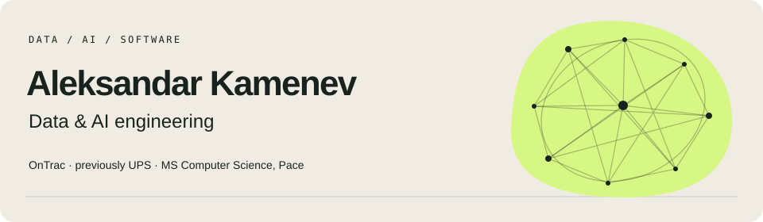

<a href="https://alex-kamenev.github.io/">
  <picture>
    <source media="(prefers-color-scheme: dark)" srcset="assets/profile-dark.svg">
    
  </picture>
</a>

**Senior Software Engineer, Data at OnTrac.** I build data pipelines, integrations, and LLM applications on Google Cloud. My background spans logistics software, full-stack development, and distributed-systems research.

**[Portfolio ↗](https://alex-kamenev.github.io/) · [LinkedIn ↗](https://www.linkedin.com/in/aleksandar-kamenev/) · [Published research ↗](https://doi.org/10.1145/3593426)**

### Work & contributions

| Work | My part |
| --- | --- |
| [SlashDB React tooling](https://github.com/SlashDB/react-slashdb) | SDK organization and setup documentation, following a [JavaScript wrapper and React hook prototype](https://github.com/SlashDB/Slashbd_React_Projects/pull/1). Contributions to SlashDB’s open-source projects. |
| [Distributed average consensus](https://doi.org/10.1145/3593426) | Co-authored research with Dariusz R. Kowalski and Miguel A. Mosteiro, published in ACM Transactions on Parallel Computing (2023). |
| [Shared browser windows](https://github.com/Alex-Kamenev/browser-window-shared-view-cube-rotation-animation) | A rotating cube whose animation and position are shared across browser windows. |
| [New York weather analysis](https://github.com/Alex-Kamenev/Weather_Data_EDA_2015_2020) | Temperature and precipitation at five stations, with [related forecasting experiments](https://github.com/Alex-Kamenev/Weather_Data_Prediction_Models). |
| [Processing sketches](https://github.com/Alex-Kamenev/Processing-Projects) | Interactive drawing, generative compositions, and animation experiments. |

### What I work with

| Focus | Tools |
| --- | --- |
| Data platforms | Python, SQL, BigQuery, Airflow, Kafka |
| AI applications | RAG, Vertex AI, Gemini, LangChain, vector search |
| Software & delivery | TypeScript, React, Node.js, FastAPI, Cloud Run, Docker, Terraform |

Previously, I led software development in **UPS’s Advanced Technology Group**, working on network digital twins, geospatial visualization, route optimization tools, and generative AI prototypes. **MS in Computer Science, Pace University.**

### Outside work

I’m building personal projects in browser game design, local AI developer tools, interactive computer science learning, and creative video. I share the ideas while keeping private source and employer IP private. I also enjoy photography and music.
